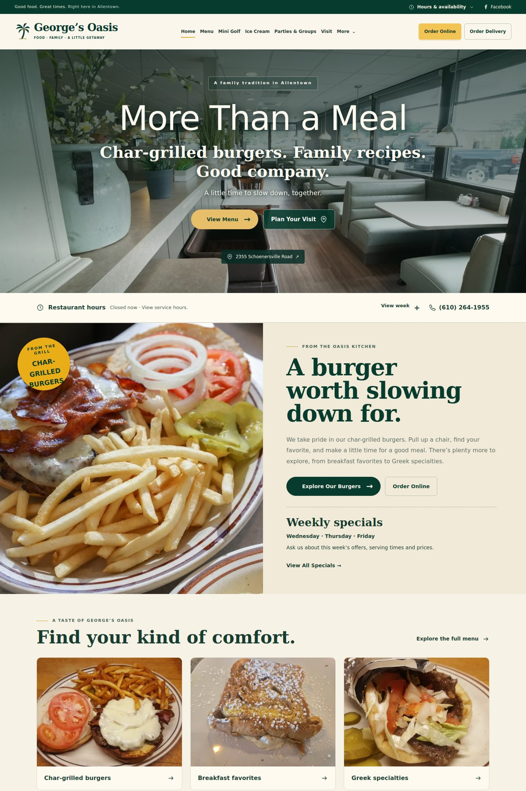
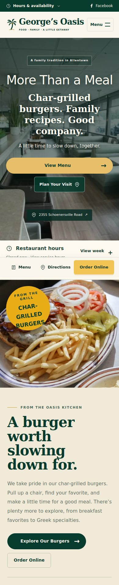
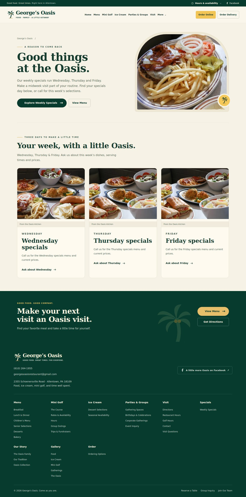

# George’s October 26 website feedback

**Latest follow-up:** [expanded photo-menu trial, matching audit, screenshots and updated test results](menu-photo-trial.md).

Source: George’s email received October 26, 2026 at 12:27 PM Eastern.
Based on main `ab7d2d0813a6083adb1f212c33b5f12d72963427`; the prior post-meeting branch was three commits behind main.

| Owner request | Reviewable change |
| --- | --- |
| More food up front, especially char-grilled burgers | Burger feature immediately after the hero/hours; three-photo food gallery; char-grilled wording; burger image on lunch/dinner menu section. |
| More visible hours | Native expandable weekly restaurant hours below the hero, live service status, click-to-call, separate dinner-hours link. Uses the existing shared schedule. |
| Prices are outdated; update or omit | All menu and dessert prices, variant prices, additions and free-text price notes hidden. Old printed-menu links/downloads hidden. All 212 dishes retained. Ordering menu remains available for current prices. |
| Specials should have menus and photographs | Wednesday/Thursday/Friday photo cards; reusable per-day dish accordions; record and dish approval/expiry controls; draft review in the authenticated owner preview. |
| Subtle UI polish | Licensed UIverse arrow/fill buttons adapted to Oasis green/gold, restrained food-photo hover, keyboard focus and reduced-motion support. |

## Remaining owner content

The shared Drive parent and RESTAURANT folder contained photos, but no dedicated specials-menu documents. The existing website lists older specials, including a Tuesday promotion that is outside the confirmed Wednesday–Friday scope. No old special prices, dish assignments or serving times have been promoted to current facts.

Obtain George’s dedicated Wednesday, Thursday and Friday menus. Add records under `special_menus` in `georges_oasis/content/site.json`. Each menu needs `id`, `weekday`, `title`, `photo`, descriptive `photo_alt`, `items`, optional `note`, and `metadata`. Each dish needs `name`, optional `description`, and its own metadata. Review the draft at `/admin/preview/specials`, then approve the menu and individual dishes with source/review date and optional validity bounds. Public cards fall back to a call action until approved dishes are available. General kitchen photos are explicitly captioned as such, not as an exact special or inclusion.

Menu pricing remains disabled through `menu_pricing.show_prices: false`. Retained source prices are historical reference only. Before enabling, update and confirm **all** prices, variants, add-ons and price notes, replace the old printed menus, and approve `menu_pricing.metadata`. A switch alone does not publish prices; approval and validity checks also have to pass.

## Verification

- `python -m flask --app app check-content`: passes.
- `git diff --check`: passes.
- Unit suite: 46 tests, 44 passing. Two existing asset-presence checks fail because the local text checkout cannot materialize all legacy binaries through the GitHub connector. `test_full_menu` reaches missing `menu-baklava.webp`; `test_public` reaches missing `georges_history.webp`. These files exist in the GitHub base tree and are not removed or modified by this PR. The same two test methods also failed on the baseline checkout (then at old printed-menu assets).
- New feedback tests cover all 212 dishes remaining, absence of price/printed-menu leaks, approval and expiry required to re-enable prices, nested specials publication controls, draft preview and homepage placement.
- Chromium: homepage, menu and specials at 320, 390, 768 and 1440 pixels. No horizontal overflow or JavaScript exceptions. Menu search/clear and weekly-hours expansion passed at every size. Native hours work with JavaScript disabled. Reduced-motion transition duration is zero.
- All newly used responsive photos were restored from existing local assets and verified against Git blob hashes. Browser image gaps are confined to unchanged legacy optimized assets (`georges_history`, `menu-avocado-toast`, `menu-vegan-flatbread`, `menu-breaded-shrimp`, `menu-baklava`). Full asset validation must be rerun from a complete Git checkout before merging.
- No database migration, dependency change, live deployment, customer email or merge.

## Visual review

The previews below show the changed homepage section and specials layout. They omit the unrelated legacy-image gaps farther down the homepage/menu. Fonts may fall back if Google Fonts is unavailable in the review environment.

UIverse source, author and full MIT notice: [THIRD_PARTY_NOTICES.md](../../../THIRD_PARTY_NOTICES.md).
