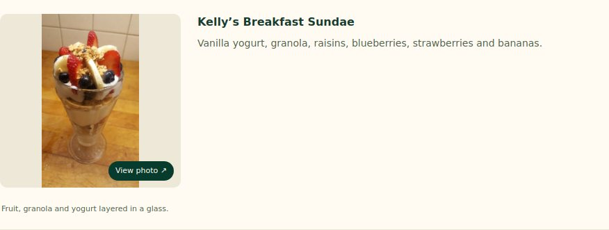
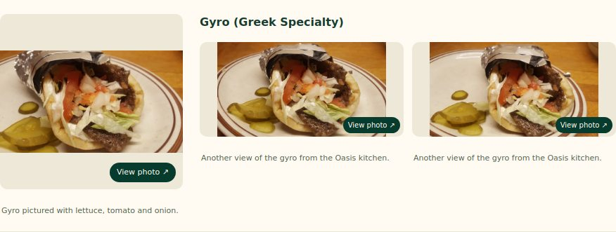
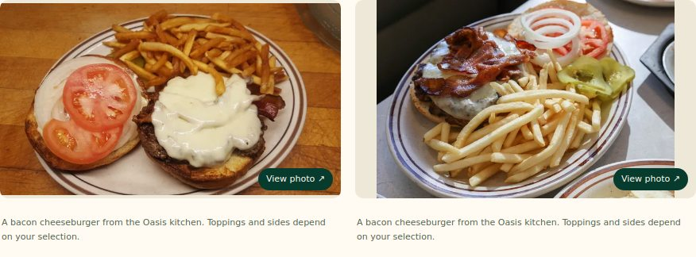
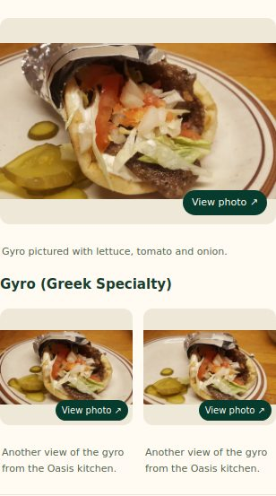

# Photo-menu trial — October 26, 2026

Continuation of PR #4, based on branch head `91dbb58ad0f15b258541e03937dd82bc2211ab4b`.

The menu retains all 212 dishes and the hidden-price policy. It now has **13 photo-backed dish rows and 21 enlargeable photo placements**: 13 primary dish images, three extra views, and five burger/sundae group images. Seventeen enlargeable placements use owner-supplied responsive photos reviewed visually in this pass; four retain existing legacy menu images. Other photos remain in category headers and the four featured-food cards.

The responsive files are alternate delivery sizes, not extra dishes or independent photos. Duplicate exports such as the repeated crab-cake files are not counted as different dishes or used to pad the menu.

## Dish matches reviewed visually

These are visual dish-type matches to the current menu descriptions, not new owner confirmation of portions or recipes. Captions describe what is shown without promising included sides.

| Menu item | Photo | Basis and limit |
| --- | --- | --- |
| Kelly’s Breakfast Sundae | Fruit-and-granola parfait | Layered yogurt, granola, banana, strawberries and blueberries visible. |
| Nutella Pancakes with Strawberries | Strawberry/Nutella pancakes | Pancakes with strawberries and chocolate spread; branded jar visible. |
| Vegan Flatbread | Vegetable-topped bread | Flatbread with cucumber, tomato and greens; dietary wording comes from the existing menu, not an inference from the photograph. |
| Oasis Greek Salad | Greek salad beside wrap/fries | Salad with feta, cucumber, onion and olives; caption explicitly says the sandwich and fries are separate. |
| Gyro (Greek Specialty) | Gyro plus two alternate views | Pita, sliced meat, lettuce, tomato and onion; all views show the same dish type. |
| Pulled Pork BBQ | Barbecue sandwich/fries | Shredded meat and barbecue sauce on a bun; fries are pictured, not promised as included. |
| Broiled or Fried Crab Cakes | Crab cakes with lemon | Crab cakes pictured; caption does not identify cooking method or guarantee sides. |
| Soft Ice Cream | Twist cone | Chocolate/vanilla soft-serve cone; seasonal availability remains qualified. |
| Greek Pastries | Rolls plus triangular pastry view | Broad pastry selection only; fillings and current availability are not inferred. |

## Deliberate accuracy boundaries

- The French-toast photo visibly contains filling. Removed it from **Golden Brown French Toast** and replaced that featured card with the better-matched pancakes. It remains a broadly labeled breakfast category photo; it is not reassigned to Debbie’s specific recipe without confirmation.
- Two bacon-cheeseburger photos illustrate the **burger group**, not Plain Burger, Bacon Bleu, Cowboy or a specific cheese recipe.
- Three sundae photos illustrate the **sundae group**, not every named flavor or size.
- Do not add chicken-and-waffles, waffle sandwiches or macaroni-and-cheese as current menu items solely because photos exist.
- Catering trays do not stand in for children’s servings; no unverified child portions were illustrated. Senior-category imagery explicitly says portions and sides may differ.
- Existing avocado toast, shrimp (two placements) and baklava item images remain unchanged. Their legacy binary files were unavailable locally, so those particular images were not visually revalidated in this pass.

## Interaction and layout

Photo-backed menu rows use a compact image/text layout on desktop and stack on mobile. Images use `object-fit: contain` so the plate is not cropped away. Each image has a descriptive caption, responsive sources, lazy loading and an ordinary image link that works without JavaScript.

The native dialog enlarges photos, supports arrow keys and Escape, and returns focus to the opening link. Navigation includes only photos visible in the current filtered menu. Search hides unrelated group galleries along with the dishes. The dessert page reuses the same enhancement.

## Test run

- Content validation and `git diff --check` pass.
- **49 of 50 unit tests pass.** The remaining asset-presence test encounters the unchanged legacy `menu-avocado-toast.webp`, which exists in the GitHub base tree but is unavailable in this local partial checkout. Complete-checkout asset verification remains required before merging.
- Chromium at 320, 390, 768 and 1440 px: no horizontal overflow or JavaScript errors. All newly used responsive image assets load. The four existing legacy item-image placements remain unavailable locally.
- At each width: search/clear, empty results, group-photo filtering, filtered viewer count, arrow navigation, Escape and return focus pass.
- No-JavaScript direct image link and dessert-page photo viewer pass.
- Regression tests preserve 212 dishes, hidden prices, draft-item suppression and the intended photo-matching boundaries.

## Previews

Desktop dish row:

Desktop gyro with alternate views:

Burger-group photographs:

Mobile gyro row:

